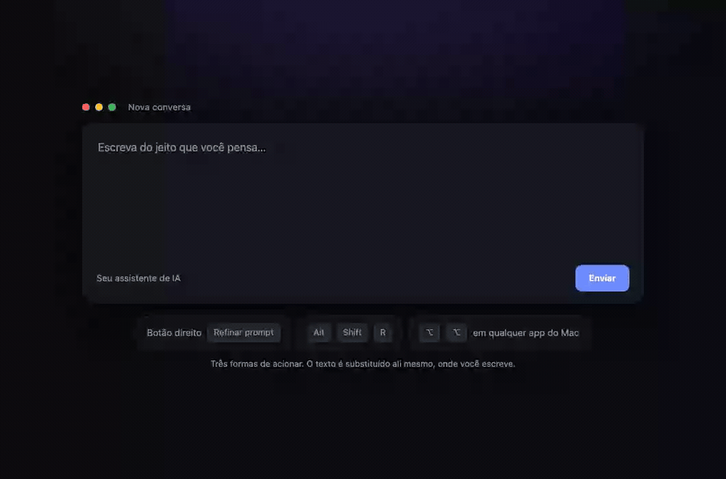

**English** | [Português](README.pt-BR.md)

# Prompt Refiner

Select the rough text you just typed — loose notes, half sentences, typos and all — and Prompt Refiner rewrites it into a well-structured prompt for the AI you are about to use. It replaces **only your selection**, right where you were writing: in Chrome, or in any Mac app.



<sub>Recorded with the real extension and a real backend — <code>extension/scripts/record-demo.mjs</code>. The refined prompt you see is the genuine output, not a mock-up.</sub>

> **Interface language:** the extension menus, the settings page, the macOS messages, the comments in `backend/.env.example` and the backend's error messages are in Brazilian Portuguese. Your prompts are refined in whatever language you wrote them in. English UI is on the [roadmap](#roadmap).

## What makes it different

- **It works where you write.** No second window, no separate chat, nothing to paste. You select, you choose, and the text in the field becomes the refined prompt. Chrome (right-click menu or a keyboard shortcut) and any Mac app that supports macOS Services, including a double tap on ⌥ Option.
- **You don't need a paid API key.** If you already pay for a Claude subscription, Prompt Refiner can use it through the official Claude Code CLI — no API credits. See [Choose the engine](#2-choose-the-engine).
- **It never invents facts about you.** The refiner organizes what you wrote and, in deep mode, adds *method* (success criteria, process, output format, a final check). It never adds data, audiences, deadlines, names or a tone you did not ask for.
- **Your text is never changed when something fails.** If the call fails, or the field moved, or the editor rejects the insertion, nothing is written. In the browser you get a notice with a **Copy prompt** button; in a Mac app the selection stays exactly as it was.
- **One click to undo**, plus the field's own ⌘Z / Ctrl+Z.
- **It runs on your own machine.** A small local backend makes one call per refinement to the AI provider *you* configured. Prompt text is never logged — only metadata.
- **It also writes instruction files.** The same loose notes can become the contents of a `CLAUDE.md` or `AGENTS.md`.

## How it works

```
Chrome extension ─────┐
                      ├─► local backend (127.0.0.1:8787) ─► your AI engine
macOS Services / ⌥⌥ ──┘             │                       (one call per refinement)
                                    ▼
          the refined prompt replaces your selection (with Undo)
```

The engine that *refines* and the destination you are *writing for* are independent: Claude can write a prompt optimized for ChatGPT, and vice versa.

## Requirements

- **Node.js 22 or newer**, and npm.
- **Google Chrome or Microsoft Edge 120 or newer** for the browser part.
- **One AI engine** — either your Claude subscription or your own API key. Both are explained below; you don't need both.
- **macOS** for the desktop integration (macOS Services and the ⌥⌥ menu bar app; the ⌥⌥ app also needs the Xcode Command Line Tools, for `swiftc`). The extension and the backend themselves are not macOS-only, but the project is developed and tested on macOS — on Windows and Linux you run the backend in a terminal instead of installing it as a service.
- A terminal, for the install. Day-to-day use needs no terminal.

> Not published on the Chrome Web Store yet, so the extension is loaded unpacked, in developer mode. That's the honest trade-off of this release — see the [roadmap](#roadmap).

## Install

### 1. Clone and install

```bash
git clone https://github.com/Dennielasouza/prompt-refiner.git
cd prompt-refiner
npm install
```

Then create your configuration file from the example:

```bash
cp backend/.env.example backend/.env
```

`backend/.env` is where the engine is configured. It is git-ignored — never commit it.

### 2. Choose the engine

#### Option 1 — your Claude subscription, no API key (recommended)

If you already pay for Claude (Pro or Max), you can use that subscription instead of buying API credits. The backend runs the official [Claude Code](https://code.claude.com) CLI in headless mode (`claude -p`), logged in as you. No API key, no card, no per-call bill: the calls count against your plan's normal usage limits and show as **US$ 0** in the cost report.

1. Install Claude Code (instructions at [code.claude.com](https://code.claude.com)) and sign in with your subscription:

   ```bash
   claude          # then run /login inside it
   ```

   The backend looks for the binary at `~/.local/bin/claude`, which is where the native
   install puts it. If yours is elsewhere, set `PROMPT_COMPILER_CLAUDE_BIN` to its absolute path.

2. Open `backend/.env` — **nothing to change**. The example already ships on this option:

   ```bash
   PROMPT_COMPILER_PROVIDER=claude-cli      # already set in .env.example
   PROMPT_COMPILER_MODEL=claude-sonnet-5-5  # already set
   PROMPT_COMPILER_EFFORT=medium            # already set
   ```

   If you are switching back from Option 2, **edit the existing `PROMPT_COMPILER_PROVIDER` line** rather than adding a second one — a duplicated key is ambiguous.

   Leave `ANTHROPIC_API_KEY` and `OPENAI_API_KEY` empty — they are deliberately **not** passed to the CLI, because an API key would override your subscription login.

That's it. A refinement takes about 4 seconds on average this way.

**What this mode is, and is not:**

- Each person signs in with **their own** subscription, in the unmodified official Claude Code binary. Prompt Refiner never asks for, stores or forwards Claude credentials — the `claude` CLI does the authentication itself, and the usage is billed by Anthropic directly to the person using it.
- **Never route other people's requests through one Claude login.** This is for your own use, on your own machine. Don't put it behind a shared endpoint.
- Don't modify the Claude Code binary. Prompt Refiner only calls it with supported flags.
- Refining a handful of prompts a day is ordinary individual use. Automating it into a high-volume pipeline is not.
- **An honest caveat:** this depends on a policy that is Anthropic's to set, and it changed more than once during 2026 — Anthropic reserves the right to act without prior notice, so this path could stop working. Option 2 is always available.

If the backend is installed as a macOS background service and it cannot read your Keychain login, generate a long-lived subscription token with `claude setup-token` and put it in `CLAUDE_CODE_OAUTH_TOKEN`. It is a credential — treat it like a password.

#### Option 2 — your own API key

Works anywhere, and does not depend on anyone's subscription policy. You pay your provider directly, per call.

Change the `PROMPT_COMPILER_PROVIDER` line already in `backend/.env` (don't add a second one) and fill in the key.

Anthropic:

```bash
PROMPT_COMPILER_PROVIDER=anthropic
PROMPT_COMPILER_MODEL=claude-sonnet-5-5
ANTHROPIC_API_KEY=your-key-here
PROMPT_COMPILER_EFFORT=medium
```

OpenAI:

```bash
PROMPT_COMPILER_PROVIDER=openai
PROMPT_COMPILER_MODEL=the-openai-model-you-prefer
OPENAI_API_KEY=your-key-here
```

There is no hardcoded model: `PROMPT_COMPILER_MODEL` is always required. Every refinement is a single call, and `npm run usage -w backend` shows what yours actually cost.

### 3. Start the backend

Start here — any OS, nothing installed into your system, Ctrl+C to stop:

```bash
npm run dev
```

It reloads when you save a **source** file. It does **not** reload when you edit `backend/.env`: stop it with Ctrl+C and start it again.

Once you know it works, macOS can run it as an always-on service that starts at login and restarts if it crashes:

```bash
npm run install-service -w backend
```

That command does three things worth knowing in advance: it installs a LaunchAgent, it **copies your `backend/.env`** to `~/Library/Application Support/PromptRefiner/` (mode 600), and it **narrows CORS to your extension's ID**. So run it again whenever you edit `.env`, move the project folder, or load the extension from somewhere else.

Don't run both — they compete for port 8787. Check that it is up:

```bash
curl -s http://127.0.0.1:8787/api/health
```

You should see `"status":"ok"` and the provider you chose. If it says `misconfigured`, the message tells you which variable is missing.

On a machine without the macOS service (Windows, Linux) and for a non-reloading run, build once and start it: `npm run build -w backend && npm start -w backend`.

To remove the macOS service later: `npm run uninstall-service -w backend` (it also deletes its copy of your `.env`).

### 4. Build and load the extension

```bash
npm run build -w extension
```

1. Open `chrome://extensions` (Edge: `edge://extensions`).
2. Turn on **Developer mode**.
3. Click **Load unpacked** and pick the `extension/dist` folder.

The settings page opens on the first install (you can reopen it by clicking the extension's icon). Check that the **Endpoint da API** is `http://127.0.0.1:8787` (if you changed `PORT` in `.env`, use that port here too) and click **Testar conexão** — it should say *Conectado*.

Now select some text in any text field, right-click, and choose **Prompt Refiner ▸ Refinar prompt**.

### 5. Optional — use it in any Mac app

The backend has to be running for either of these.

**macOS Services** (works in Claude, ChatGPT, TextEdit, Notes, Mail, Slack and anything else that supports Services):

```bash
npm run install-services -w desktop
```

That installs 14 Services, two of them with shortcuts:

| Service | What it does |
|---|---|
| **Refinar prompt (Automático)** — **⌃⌥⌘R** | Balanced mode; destination detected from the frontmost app (Claude app → Claude, ChatGPT app → ChatGPT, Gemini web app → Gemini, everything else → generic) |
| **Refinar prompt profundo (Automático)** — **⌃⌥⌘P** | Deep mode, same detection |
| Refinar prompt \[profundo] para ChatGPT / Claude / Gemini / Codex / Claude Code | A fixed destination, balanced or deep |
| **Gerar CLAUDE.md** / **Gerar AGENTS.md** | Turns your notes into an agent instruction file |

Use them with the shortcut, with right-click › **Services**, or from the app's own menu (*Claude › Services*, for example). Undo with **⌘Z** in the app. If the items don't appear in an app that was already open, quit and reopen it. Shortcuts can be changed in **System Settings › Keyboard › Keyboard Shortcuts › Services › Text**. Remove everything with `npm run uninstall-services -w desktop`.

**Double tap on ⌥ Option** (a tiny ✦ menu bar app):

```bash
npm run install-hotkey -w desktop
```

| Gesture | Action |
|---|---|
| **⌥⌥** — a quick double tap on Option | Refine (Automatic), balanced |
| **⇧ + ⌥⌥** — hold Shift, double tap Option | Refine (Automatic), deep |

On first run, allow **Prompt Refiner** in **System Settings › Privacy & Security › Accessibility**. The app starts at login; pause or quit it from the menu bar icon. Normal ⌥ shortcuts (⌥←, for instance) don't trigger it. Remove it with `npm run uninstall-hotkey -w desktop`.

It works by copying the selection (⌘C, saving and restoring your clipboard), calling the local backend, showing a floating notice, and — **only on success**, and only if the same app is still in front — pasting the result (⌘V). It watches modifier keys only, to recognize the gesture; it never reads or stores what you type.

Three things to know about it:

- **Rebuilding the app invalidates the Accessibility permission.** It is signed ad hoc, so every build is "a different app" to macOS: you have to **remove it (−) and add it again** in Accessibility — toggling it off and on is not enough.
- **The Claude desktop app uses ⌥⌥ too**, for its own quick entry. To use ⌥⌥ here, turn that off in *Claude › Settings › System*.
- ⌘C/⌘V are sent by key position: fine on US and ABNT2 layouts, not on Dvorak-style ones (use the Services there).

## How to use it

### In the browser

1. Write in any text field — ChatGPT, Claude, Gemini, or any `<input>`, `<textarea>` or rich editor.
2. Select the part you want refined.
3. Right-click inside the field → **Prompt Refiner**, and pick one of:
   - **Refinar prompt** — balanced
   - **Refinar prompt (profundo)** — deep
   - **Gerar arquivo de instruções** — a `CLAUDE.md` or `AGENTS.md`
4. Choose the destination. **✨ Automático** reads it from the site: `chatgpt.com` and `chat.openai.com` → ChatGPT, `claude.ai` → Claude, `gemini.google.com` and `aistudio.google.com` → Gemini, anything else → a generic prompt. Codex and Claude Code are never guessed — pick them yourself.
5. The selection is replaced, and a notice offers **Desfazer** (undo).

**Keyboard shortcut: Alt+Shift+R** refines the selection using the default destination and depth from the settings page. Change the key at `chrome://extensions/shortcuts`.

The menu only appears inside editable fields. If something fails where the extension cannot draw a notice (`chrome://` pages, the Chrome Web Store, PDFs), the extension icon shows a red **!** — hover it for the reason, or open the settings page, which shows the last problem.

### Balanced or deep

| Mode | What it does | Good for |
|---|---|---|
| **Balanced** | Organizes and clarifies what you wrote: goal, the context you gave, constraints, format. | Everyday requests — your request, just clearer. |
| **Deep** | Also adds the *method* an experienced practitioner would use: success criteria, what to evaluate, how to handle uncertainty, an output format that forces quality, a final check. | Analysis, critique, writing that matters, code, agent tasks. |

Neither mode invents facts about your situation. Trivial requests ("fix this sentence") stay short even in deep mode.

### Output format

By default the refined prompt is **Markdown** — `##` sections, lists, **bold** for the essentials, code fences for data, and no XML tags. Simple requests stay as plain sentences. In the settings page, **Formato do prompt › Automático** lets the destination decide instead (Claude and Claude Code may then get XML tags).

### `CLAUDE.md` and `AGENTS.md`

Write loose notes about a project — *"react native app with expo, run with npx expo start, tests with jest, never commit google-services.json"* — select them, and use **Gerar arquivo de instruções › CLAUDE.md** (for Claude Code) or **AGENTS.md** (for Codex and other agents), or the matching macOS Service.

What comes back is the content of the file an agent reads at the start of every session: commands, structure, conventions, boundaries — **built only from what is in your notes**. Nothing is invented: anything essential that's missing (the test command, say) becomes a `TODO:` line for you to fill in.

## Settings

Two places, and they do different things.

**The extension's settings page** (click the extension icon) holds: the backend address, the default destination and depth used by the keyboard shortcut, and the output format. These live in Chrome's own `chrome.storage.sync`.

**`backend/.env`** holds the engine:

| Variable | Required | What it does |
|---|---|---|
| `PROMPT_COMPILER_MODEL` | **yes** | The refiner model, e.g. `claude-sonnet-5-5`. No model is hardcoded. |
| `PROMPT_COMPILER_PROVIDER` | no | `anthropic`, `openai` or `claude-cli`. If empty, whichever API key is set is used (Anthropic wins if both are). |
| `ANTHROPIC_API_KEY` / `OPENAI_API_KEY` | for options 2 | Your provider key. It only ever exists in the backend. |
| `PROMPT_COMPILER_EFFORT` | no | `low`, `medium` or `high`. `medium` is the project's default: on the 18-case eval it matched `high` in quality with fewer output tokens and less waiting. Leave it empty for models that don't take the parameter. |
| `PROMPT_COMPILER_CLAUDE_BIN` | no | `claude-cli` only: absolute path of the `claude` binary (default `~/.local/bin/claude`). |
| `CLAUDE_CODE_OAUTH_TOKEN` | no | `claude-cli` only, a fallback when the service can't reach your Keychain login. A credential — never share it. |
| `PROMPT_DEFAULT_FORMAT` | no | Format used when a request doesn't ask for one: `markdown` (default) or `auto`. |
| `PORT` / `HOST` | no | Defaults `8787` and `127.0.0.1` (reachable only from your own machine). |
| `PROMPT_COMPILER_TIMEOUT_MS` | no | Timeout of the engine call (default `45000`). |
| `PROMPT_COMPILER_MAX_TOKENS` | no | Output cap for the refiner model (default `16000`). |
| `ALLOWED_ORIGINS` | no | Accepted CORS origins, comma-separated (default `chrome-extension://*`). `install-service` narrows this to your own unpacked extension's ID unless you set it yourself. |
| `ANTHROPIC_REFUSAL_FALLBACK` | no | On Claude 5.x models, retries a refused request on a fallback model. On by default; `false` disables it. |

### What each refinement cost you

Every call logs its tokens and an estimated cost — never the text.

```bash
npm run usage -w backend                  # the whole history
npm run usage -w backend -- --days 7      # the last 7 days
npm run usage -w backend -- --detalhes    # with tokens and cache details
```

That history is the backend's own log at `~/Library/Logs/PromptRefiner/backend.log`, written when it runs as a macOS service. It lives outside the project and holds metadata only — tokens, timings, costs, never prompt text. Delete the file to clear it; `npm run uninstall-service -w backend` removes the service and its copy of your `.env`, but leaves the log.

Subscription calls (`claude-cli`) are listed separately, at US$ 0, with the value they *would* have cost on the API for comparison. The prices used for the estimates live in `backend/src/config/pricing.ts`; unknown models get no estimate.

## Troubleshooting

| What you see | What it means | What to do |
|---|---|---|
| `"status":"misconfigured"` from the health check | A required variable is missing. The `message` field names it — **in Brazilian Portuguese**. | Set it in `backend/.env`. If the backend runs as a macOS service, run `npm run install-service -w backend` again afterwards. |
| `EADDRINUSE` on start, or the health check answers something you don't recognise | Port 8787 is already taken — often by a second copy of this backend. | Stop the other one, or set `PORT` in `.env`, and then put the same port in the extension's **Endpoint da API**. |
| You edited `.env` and nothing changed | `npm run dev` only watches source files; the macOS service reads a *copy* of your `.env`. | Dev: Ctrl+C and start again. Service: `npm run install-service -w backend`. |
| The settings page says *Desconectado* | The extension cannot reach the backend. | Check the health URL in a terminal; make sure the endpoint matches `PORT`; use `127.0.0.1` rather than `localhost`. If you loaded the extension from a different folder after installing the service, run `npm run install-service -w backend` again — CORS is locked to the extension's ID. |
| `claude: not found`, or `auth` errors with `claude-cli` | The CLI isn't where the backend expects, or it isn't signed in. | `claude` then `/login`. If the binary is elsewhere, set `PROMPT_COMPILER_CLAUDE_BIN` to its absolute path. If the service can't read your Keychain, use `CLAUDE_CODE_OAUTH_TOKEN`. |
| The right-click menu isn't there | The menu only appears inside editable fields, and never in password fields. | Click into a text box first. `chrome://` pages and the Web Store are off-limits to every extension. |
| Nothing happens and the text is unchanged | That is the intended failure mode. | Open the extension's settings page: the **Último problema** section shows the last failure. |

## Privacy, in plain words

The full statement is in [PRIVACY.md](PRIVACY.md). The short version:

- **There is no server of ours.** The backend runs on your computer. Nothing is sent to the author of this project, ever.
- **Only what you selected is sent**, plus your browser's language and — in Automatic mode only — the domain name of the site you are on (`chatgpt.com`, never the full address). It is read at the moment you click, and never at any other time.
- **The text you selected does go to the AI provider you configured** — Anthropic, OpenAI, or your own Claude subscription — because that is how it gets refined. That provider's own privacy terms apply to it.
- **Password fields are refused** before anything is sent.
- **Prompt text is never logged.** The backend's log has metadata only: destination, depth, character counts, timings, tokens, estimated cost. An automated test enforces this.
- **Minimal permissions**: `contextMenus`, `activeTab`, `scripting`, `storage`. No `host_permissions`, no static content scripts, no access to your history, cookies or tabs, no remote code, no analytics.
- **The AI's output is treated as untrusted**: validated, then inserted as plain text only — never as HTML.

The backend has no authentication and no rate limiting, which is fine for something listening on `127.0.0.1`. Add both before putting it anywhere else.

## Known limitations

- Not on the Chrome Web Store yet; the extension is loaded unpacked.
- The local backend has to be running.
- The desktop integration is macOS-only.
- Google Docs is not supported (its editor is drawn on a canvas). Neither are `chrome://` pages, the Chrome Web Store, PDFs, or `input type="email"` / `number`. Cross-origin iframes only work when Chrome grants access to the frame you clicked in.
- If a site handles pasting in its own way — turning a long paste into an attachment, for instance — the extension notices the text didn't go in, changes nothing, and offers to copy the prompt.
- The ⌥⌥ app sends ⌘C/⌘V by key position: US and ABNT2 layouts, not Dvorak.
- Undo does not survive a page reload. That is deliberate: no persistent history.
- The interface is in Brazilian Portuguese only.

## Roadmap

- **Chrome Web Store release — v2.** The goal is that nobody has to open a terminal. It needs a packaged engine that works without a local backend, so it is a version of its own, not a patch. No date.
- English interface / i18n.
- Desktop integration for Windows and Linux (global shortcut + clipboard).
- Firefox support.

---

## For developers

### Architecture

One LLM call per refinement, with structured output. That single call covers intent analysis, task classification, complexity (1–5), destination adaptation and generation; a deterministic quality gate (`backend/src/engine/output.ts`) then validates the result. Destination adapters change *how* instructions are structured, never *what* the task is. Deep mode draws its method from per-task playbooks (`backend/src/engine/playbooks.ts`) and applies it fully only to complex tasks.

The system prompt is assembled from cacheable parts first and the destination part last: core → depth → format → destination.

```
shared/      The contract between extension, backend and desktop (destinations, depths, formats,
             kinds, limits) and the site → destination map. Single source of truth.
backend/     Fastify server (src/server.ts), prompt engine (src/engine/), providers
             (src/providers/: anthropic, openai, claude-cli), pricing (src/config/pricing.ts),
             cost report (src/usage/), eval and service scripts (scripts/)
extension/   Chrome MV3: background.ts (menus, on-demand injection, backend call),
             content.ts + dom/editable.ts (capture and replace the selection), ui/toast.ts,
             options page, build script, tests and fixtures
desktop/     macOS: src/refine.ts (the CLI the Services call), scripts/services.mjs (installer),
             helper/ (the Swift ⌥⌥ menu bar app)
```

`backend`, `extension` and `desktop` are npm workspaces; `shared` is imported directly by all three.

### API

`POST /api/refine`

```json
{ "text": "raw prompt", "target": "claude", "depth": "deep", "format": "markdown", "kind": "prompt", "language": "en-US" }
```

`target`: `auto | generic | chatgpt | claude | gemini | codex | claude-code`. `depth`: `balanced` (default) or `deep`. `format`: `markdown` or `auto` (default: `PROMPT_DEFAULT_FORMAT`). `kind`: `prompt` (default), `claude-md` or `agents-md` — for those two the target is implied. `hostname` is only sent, and only used, with `target: "auto"`.

`200` returns `{ refinedPrompt, target, depth, format, kind, taskType, complexity, strategies, warnings }` (`strategies` is always `[]`, kept for compatibility). Errors return `{ "error": { "code", "message" } }`: `400` invalid input · `403` origin not allowed · `413` text over 12,000 characters · `415` not JSON · `422` the model refused · `502` provider error or invalid model output · `503` backend not configured, or rate-limited · `504` timeout.

`GET /api/health` reports status, provider and the compiler version.

### Replacement

The selection is captured synchronously the moment you click, before the async call; afterwards exactly that passage is replaced, and only if it is verifiably still there.

- `input` / `textarea`: `execCommand("insertText")`, so frameworks like React see real input events and native undo keeps working; falls back to `setRangeText`. In an `<input>`, line breaks become spaces.
- `contenteditable`: checks the selected text is still in place, then tries, in order and verifying each one — a synthetic `paste` event (rich editors such as ProseMirror/Tiptap, Lexical, Quill, Slate and Draft insert it through their own model), `execCommand("insertText")`, and finally direct DOM editing.
- If the text changed and replacement isn't safe, nothing is modified and the notice offers **Copiar prompt**.

### Commands

```bash
npm install
npm test                        # unit tests of the three workspaces (desktop compiles Swift — macOS only)
npm run typecheck
npm run lint                    # Biome (lint + format check); npm run lint:fix applies safe fixes
npm run build
npm run test:e2e -w extension   # Playwright + Chromium with the real extension
npm run eval -w backend         # the 18-case eval against the real engine
npm run usage -w backend        # cost report
```

- On Linux and Windows, run the unit tests per workspace: `npm test -w backend && npm test -w extension`.
- The e2e suite needs Playwright's Chromium once (`npx playwright install chromium`). It loads the real extension against a real backend with a deterministic fake provider, so it costs nothing.
- `npm run eval -w backend` makes real calls: it costs API money on `anthropic`/`openai`, and counts against your plan on `claude-cli`. Filter by case name with `npm run eval -w backend -- FILE`.
- Manual test pages: `extension/test/fixtures/index.html` (input, textarea, contenteditable, a password field, a React-style textarea) and `editors.html` (Tiptap/ProseMirror, Quill, Lexical). Serve them with any static server, e.g. `npx http-server extension/test/fixtures -p 5500`.

### How to verify a change

- **Backend:** `npm test -w backend && npm run typecheck -w backend`. Engine changes also need the eval.
- **Changing the refiner instruction** (`backend/src/engine/instruction.ts`): bump `COMPILER_VERSION`, run the tests and the eval, reinstall the service, and confirm the version with `curl -s http://127.0.0.1:8787/api/health`.
- **Extension:** unit tests, `npm run test:e2e -w extension` (run it twice), and a build. Delete `extension/dist-e2e` afterwards. After rebuilding, click ↻ on the extension's card in `chrome://extensions`; if you forget, the extension detects the mismatch on next use and reloads itself.
- **Desktop:** `npm test -w desktop` (includes the Swift tests).
- **Installed backend:** `launchctl print gui/$(id -u)/com.promptrefiner.backend`, with the log at `~/Library/Logs/PromptRefiner/backend.log`.

The rules that must not be broken — no prompt text in logs, no invented facts, the user's text never changes on failure, no new extension permissions — are in [`CLAUDE.md`](CLAUDE.md), which is also what coding agents read. [CONTRIBUTING.md](CONTRIBUTING.md) has the PR checklist.

## Contributing

Issues and pull requests are welcome, in English or Portuguese — see [CONTRIBUTING.md](CONTRIBUTING.md) and the [Code of Conduct](CODE_OF_CONDUCT.md).

Security problems: please don't open a public issue. [SECURITY.md](SECURITY.md) explains how to report privately.

## License

[MIT](LICENSE) © Denniela Souza
